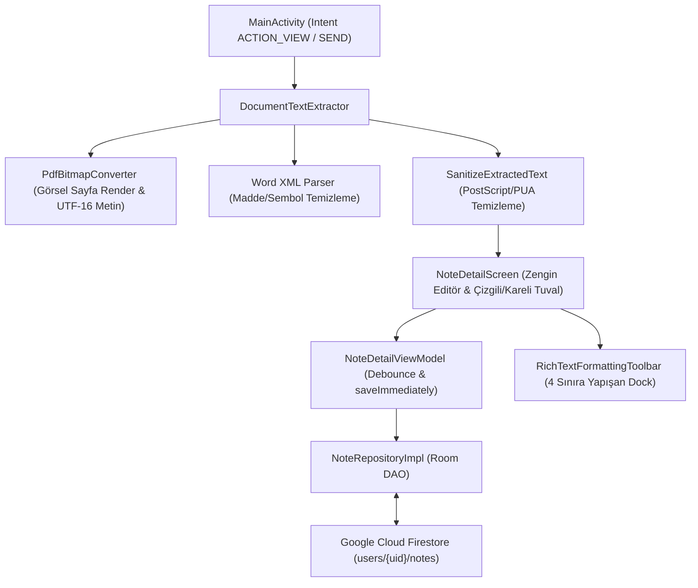

# SharkMentor — Notlar ve Editör Mimarisi Geliştirme Günlüğü & Kaynak Dokümanı

> **Doküman Türü:** Google NotebookLM Kaynak Dokümanı (Study Guide & Technical Manifesto)  
> **Uygulama:** SharkMentor (Android / Kotlin Jetpack Compose)  
> **Tarih Aralığı:** 28 - 29 Ekim 2026  
> **Geliştirici Rolleri:** Kullanıcı & Jarvis (AI Asistanı)  

---

## 1. Giriş ve Proje Özeti

Bu doküman, **SharkMentor** Android uygulamasında yürütülen zengin metin düzenleyici (Rich Text Editor), gelişmiş sayfa dokuları (çizgili, kareli, noktalı kağıt desenleri), 4 sınıra yapışabilen dinamik hareketli araç çubuğu (Floating & Docking Toolbar), PDF/Word belge ayrıştırma motoru, Firestore / Room senkronizasyonu ve geniş ekran (tablet/foldable) adaptasyonuna ilişkin tüm kullanıcı isteklerini, teknik analizleri, mimari tasarımları ve kod değişikliklerini kronolojik ve kavramsal olarak bir araya getiren ana kaynak metindir.

Google NotebookLM'e yüklendiğinde; sistemin çalışma prensiplerini analiz edebilir, sesli özetler (Audio Overview/Podcast) oluşturabilir, sıkça sorulan sorulara (FAQ) yanıt alabilir ve kod tabanına dair tüm mimari soruları yanıtlayabilirsiniz.

---

## 2. Kronolojik Sohbet ve Geliştirme Süreci (Tüm Talepler & Çözümler)

### Adım 1: Zengin Metin Biçimlendirme ve Klavye Hizalama
* **Kullanıcı Talebi:** Notlar sekmesinde yazı rengi, vurgu, italik, altını çizme ve maddeleme çalışmıyor. Vurgu rengi seçeneği ekle. Yazarken alttaki kontrol panelinin klavyenin hemen üzerinde sıfır kalmasını sağla.
* **Tespit:** `TextFieldValue` üzerinde AnnotatedString SpanStyle stilleri anlık yazı girişinde kayboluyordu. Sanal klavye açıldığında `WindowInsets.ime` padding'i eksikti.
* **Yapılanlar:**
  * `NoteRichTextHelper` sınıfı genişletildi; imleç konumundaki stilleri koruyan `handleTextChange` mekanizması kuruldu.
  * İtalik, altı çizili, kalın (`SpanStyle`) etiketleme sistemi inşa edildi.
  * Sanal klavye açıldığında alt araç çubuğunun klavye yüksekliği kadar yukarı kalkması (`WindowInsets.ime.asPaddingValues()`) sağlandı.

---

### Adım 2: Renk Menüsü Tasarımı, Kontrol Kutusu ve Belge Ayrıştırma
* **Kullanıcı Talebi:** Kalem ve vurgu renklerini tek sembolde topla; tıklanınca yukarı doğru ince panel açılsın. Özel renk seçici ve dinamik tema renkleri ekle. İşaretlenebilir (`[ ]` / `[✓]`) yapılacaklar listesi ekle. PDF/Word açılışındaki garip sembolleri düzelt. Not AI özetlerini detaylandır.
* **Yapılanlar:**
  * Kalem ve fosforlu vurgu seçimleri için kompakt açılır panel (`ActiveColorPanel.PEN` ve `ActiveColorPanel.HIGHLIGHT`) yapıldı.
  * HSV tabanlı özel renk seçici iletişim kutusu (`CustomColorPickerDialog`) eklendi.
  * Tıklanabilir kontrol kutusu maddeleri tasarlandı.
  * `GeminiCoreService` içindeki not analizi istemleri (prompts) genişletilerek 12.000 karaktere kadar kapsamlı ve pedagojik özet çıkaracak şekilde güncellendi.

---

### Adım 3 & 4: Otomatik Yeni Not Oluşturma, PDF Dışa Aktarma ve Kağıt Desenleri
* **Kullanıcı Talebi:** AI özetleri otomatik olarak yeni bir not olarak kaydedilsin. Üst bara 3 nokta menüsü eklenip ayarlar buraya toplansın. Notları cihaza PDF olarak aktarma özelliği ve çizgili/kareli kağıt seçenekleri eklensin.
* **Yapılanlar:**
  * AI özet çıktısı tamamlandığında `saveAiSummaryAsNewNote` ile arka planda otomatik yeni not oluşturulması sağlandı.
  * Dikey 3 nokta menüsü (`DropdownMenu`) entegre edildi.
  * `PdfExporter` sınıfı oluşturularak Android `PdfDocument` API'si ile not başlığı, gövdesi, tarih ve sayfa numaralarını içeren vektörel PDF dışa aktarma sistemi yazıldı.
  * `Canvas.drawBehind` üzerinde matematiksel aralıklarla hesaplanan çizgili (`RULED`), kareli (`GRID`), noktalı (`DOTS`) ve düz (`BLANK`) defter sayfaları geliştirildi.

---

### Adım 5: Minimalizm İlkesi
* **Kullanıcı Talebi:** Tasarımda aşırı emoji kullanımından kaçınılması, uygulamanın ana kimliği olan minimalist, sade ve açıklayıcı çizginin korunması.
* **Yapılanlar:** Arayüzdeki tüm gereksiz emojiler kaldırıldı; Material 3 standart ikonları ve sade tipografi benimsendi.

---

### Adım 6 & 7: Klavye-Bar Arasındaki Boşluk ve Odak Sayacı Hataları
* **Kullanıcı Talebi:** Shark AI ve Notlar sekmelerinde klavye açıldığında bar ile klavye arasında kalan 5mm'lik boşluğu gider. Beyaz sayfa seçeneği ekle. "Kaydet" yazısını 3 nokta menüsüne taşı. Kronometre halkasındaki kuyruk görsel hatasını düzelt.
* **Yapılanlar:**
  * Çift padding (`imePadding()` + `navigationBarsWithImePadding()`) çakışması giderilerek klavyeye tam sıfır oturan `effectiveBottomPadding` mantığı kuruldu.
  * Shark AI arayüzündeki klavye kapalıyken havada durma hatası düzeltildi.
  * Kağıt tonlarına `#FFFFFF` (Saf Beyaz Kağıt) seçeneği eklendi.
  * "Kaydet" işlemi üst çubuktan alınıp 3 nokta menüsü içine temiz bir seçenek olarak yerleştirildi.
  * Odak sayacı metronom animasyonundaki sweep gradient kuyruk açısı sınırlandırılarak temiz bir dairesel ilerleme sağlandı.

---

### Adım 8 & 9: Dinamik 4 Sınıra Yapışan Araç Çubuğu (Docking Toolbar)
* **Kullanıcı Talebi:** Alt barı ekranda gezdirilebilir yap. Ekranda istenilen yere taşınabilsin, 4 sınırdan (alt, üst, sol, sağ) birine yaklaştırıldığında sıfıra sıfır yapışsın. Taşımak için uzun basılsın, istendiğinde küçültülebilsin.
* **Yapılanlar:**
  * `ToolbarDockState` yapısı kuruldu (`BOTTOM`, `TOP`, `LEFT`, `RIGHT`, `FLOATING`).
  * 4 sınır için Öklid mesafesi eşzamanlı hesaplanarak eşik mesafesinde (snap threshold) kenara manyetik yapışma ve kenar ışıması sağlandı.
  * Taşıma işlemi için `detectDragGesturesAfterLongPress` ile dokunsal geri bildirim (Haptic Feedback) eklendi.

---

### Adım 10 & 11: Baloncuk (Bubble) Çift Dokunma & Yan Kenar Serbest Konumlandırma
* **Kullanıcı Talebi:** Küçültüldüğünde geri açılamama sorunu düzeltilsin. Araç çubuğu sağ veya sol kenara yapıştırıldığında dikey ince bir şeride (54dp) dönüşsün. Baloncuk veya şerit kenarlarda ortaya kilitlenmesin, kullanıcının bıraktığı yükseklikte serbest kalsın.
* **Yapılanlar:**
  * `awaitEachGesture` ile sürükleme mesafesi `touchSlop` eşiğinin altındaysa tıklama (açılma) eylemi ayrıştırıldı.
  * Sol/sağ sınırlarda araç çubuğunun dikey düzene geçmesi sağlandı.
  * `dockedY` durum değişkeni tanımlanarak dikey eksende kullanıcının bıraktığı kesin Y koordinatına sabitlendi.

---

### Adım 12: Not Sabitleme (Pinning) ve Büyük Ekran (Tablet) Uyumluluğu
* **Kullanıcı Talebi:** Not sabitleme çalışmadı, sabitlemeyi düzelt. Notlar sekmesini büyük ekranlarla (tablet, katlanabilir) uyumlu hale getir.
* **Kök Neden & Çözüm:**
  * **JavaBean Uyumsuzluğu:** Kotlin'deki `val isPinned: Boolean` alanı Firestore POJO serileştiricisinde `"pinned"` adıyla saklanıyordu. Geri okunurken `"isPinned"` arandığında `null` dönüp Room'daki sabitlemeyi `false` ile eziyordu. Hem `"isPinned"` hem `"pinned"` çift yönlü eşitlendi.
  * **Anında Kayıt:** `onPinnedChanged` tetiklendiğinde `saveImmediately()` çağrıldı.
  * **Çift Kayıt Engellendi:** Editörden çıkışta yeni not için tekrar `saveNote` çağrılması önlendi.
  * **Adaptive Grid:** Sabit 2 sütun yerine `BoxWithConstraints` ile ekran genişliğine göre 2, 3, 4, 5 veya 6 sütuna dinamik uyum sağlandı.
  * **Ekran Ergonomisi:** Arama çubuğu 720dp, editör metin alanı 840dp ile sınırlandırılarak tabletlerde okuma ergonomisi güvenceye alındı.

---

### Adım 13: PDF & Word Dosyalarındaki Garip Sembollerin Kökten Temizlenmesi
* **Kullanıcı Talebi:** PDF veya Word dosyası açtıktan sonra en altta veya en üstte garip semboller, kodlar çıkıyor; bunu düzelt.
* **Kök Neden & Çözüm:**
  * PDF'in PostScript font operatörleri (`/F1 12 Tf`), matrisleri (`1 0 0 1 72 712 Tm`), dosya sonu indeksleri (`xref`, `trailer`, `startxref`, `%%EOF`) ve ham ikili tarama artıkları ayıklandı.
  * CID alt küme hex glif dizileri (`!#$%&'()*+,-...`) filtrelendi.
  * Word Wingdings/Symbol karakterleri (`\uF0B7`, `\uF0A7`, `\uF0FE`) standart Unicode'a dönüştürüldü; görünmez kontrol kodları temizlendi.
  * `[PDF_PAGE:...]` etiketlerinin metin kutusuna sızması engellendi.

---

## 3. Temel Mimari Bileşenler ve Görevleri

### 1. `com.example.sharkmentor.core.util.DocumentTextExtractor`
* **Görevi:** PDF, DOCX, DOC ve TXT dosyalarından insan tarafından okunabilir en temiz metni çıkarmak.
* **Kritik Metotlar:**
  * `extractCleanText(context, uri, displayName, mimeType)`: Giriş kapısı.
  * `cleanPrivateUseAndControlChars(text)`: Wingdings ve görünmez karakter temizleyici.
  * `decodeXmlEntities(raw)`: HTML/XML varlık çözücü.
  * `sanitizeExtractedText(text)`: PostScript komutları, operatörler ve anlamsız glif dizilerini eleyen filtre motoru.

### 2. `com.example.sharkmentor.core.util.PdfBitmapConverter`
* **Görevi:** PDF sayfalarını Android `PdfRenderer` ile yüksek kaliteli JPEG dosyalarına dönüştürmek ve metin akışlarını (Streams) çözmek.
* **Önemli Nokta:** Scanned/resim ağırlıklı PDF'lerde ham ikili veriyi metin sanıp dump etmez; sayfaları görsel önizleyiciye aktarır ve metin alanını temiz tutar.

### 3. `com.example.sharkmentor.ui.screens.notes.NoteRichTextHelper`
* **Görevi:** Jetpack Compose `BasicTextField` üzerinde zengin metin düzenleme motoru.
* **Yetkinlikler:** Kalın, italik, altı çizili, 8 renk mürekkep, 6 renk fosforlu vurgu, interaktif yapılacaklar listesi (`[ ]` / `[✓]`).

### 4. `com.example.sharkmentor.ui.screens.notes.NoteDetailScreen`
* **Görevi:** Kullanıcı etkileşimli not düzenleyici arayüzü.
* **Yetkinlikler:**
  * `ToolbarDockState`: 4 sınıra (Alt, Üst, Sol, Sağ) yapışabilen ve serbest yüzebilen (Floating) araç çubuğu.
  * Küçültülmüş yüzen baloncuk modu.
  * Vektörel PDF dışa aktarma menüsü.
  * Tabletler için 840dp merkezli ergonomik metin tuvali.

### 5. `com.example.sharkmentor.ui.screens.notes.NotesScreen`
* **Görevi:** Notların listelendiği ana paneli.
* **Yetkinlikler:** Ekran boyutuna göre 2 ila 6 kolon arasında dinamik ölçeklenen adaptive staggered grid, sabitlenen notlar bölümü, minimalist arama ve boş durum kartı.

---

## 4. Google NotebookLM'de Kullanım Kılavuzu

Bu dokümanı Google NotebookLM'e ekleyerek aşağıdaki adımları gerçekleştirebilirsiniz:

1. [notebooklm.google.com](https://notebooklm.google.com) adresine gidin.
2. **"Yeni Not Defteri" (New Notebook)** oluşturun.
3. Proje klasöründeki [SharkMentor_NotebookLM_Kaynagi.md](file:///c:/Users/hp/AndroidStudioProjects/SharkMentor/SharkMentor_NotebookLM_Kaynagi.md) dosyasını kaynak (Source) olarak seçip yükleyin.
4. **Yapabileceğiniz İncelemeler:**
   * **Podcast (Audio Overview):** İki yapay zeka sunucusunun SharkMentor uygulamasının nasıl geliştirildiğini, klavye sorunlarının nasıl çözüldüğünü ve mimarisini tartıştığı derinlemesine bir sesli podcast oluşturun.
   * **Soru-Cevap (Chat):** *"Firestore'da not sabitleme sorunu neden kaynaklandı?", "PDF ve Word dosyalarındaki garip semboller nasıl temizlendi?", "Araç çubuğunun 4 sınıra yapışma mantığı nedir?"* gibi sorular sorun.
   * **Çalışma Rehberi (Study Guide):** Geliştirme sürecinin aşamalarını özetleyen bir teknik sınav veya çalışma kılavuzu türetin.
